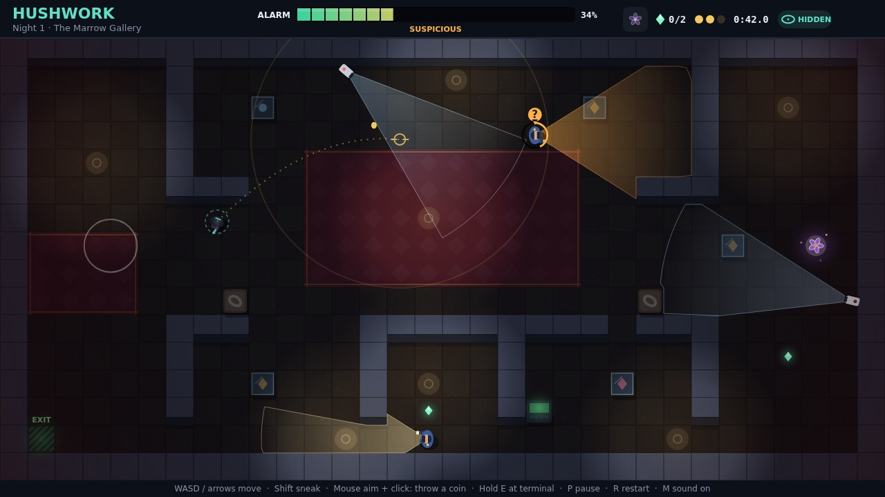

# Hushwork

[](https://make.fun/bounty/best-heist-game-20261122-0559)
[](https://make.fun/bounty/best-heist-game-20261122-0559)
[](https://make.fun/bounty/best-heist-game-20261122-0559)

A top-down stealth heist across three nights in Vesper City. Sneak through each room past
guards and their torch beams, sweeping cameras and laser grids. Loop the camera feeds at a
terminal, throw coins to pull guards away, take the prize and slip out the exit before the
alarm meter fills and lockdown seals the doors.



- **WASD / arrow keys** move, **Shift** sneaks (silent, slower)
- **Mouse** aims, **click** throws a coin to make a noise
- **Hold E / Space** at a terminal to loop cameras and lasers
- **P** pauses, **R** restarts, **M** toggles sound

Art, sound and music are drawn and synthesized in code at runtime. No assets are downloaded,
and the game makes no network requests.

## Run it

Open `game/index.html` in desktop Chrome. Or serve the folder:

```sh
node serve.ts        # serves game/ at http://localhost:8080
```

There is no build step. `node tools/shoot.mjs` retakes the screenshots in headless Chrome, and
`node tools/playtest.mjs` plays the game with real keyboard and mouse input (serve it first).

---

[make.fun](https://make.fun/?ref=vbrytm16)
